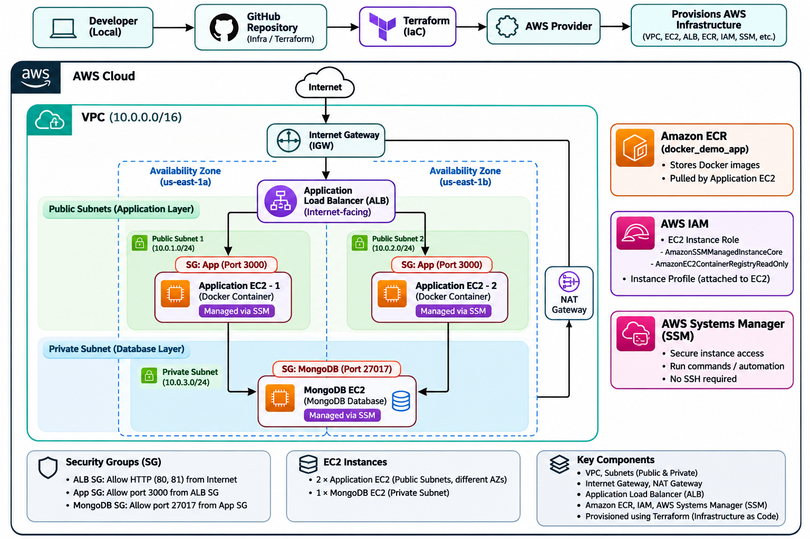
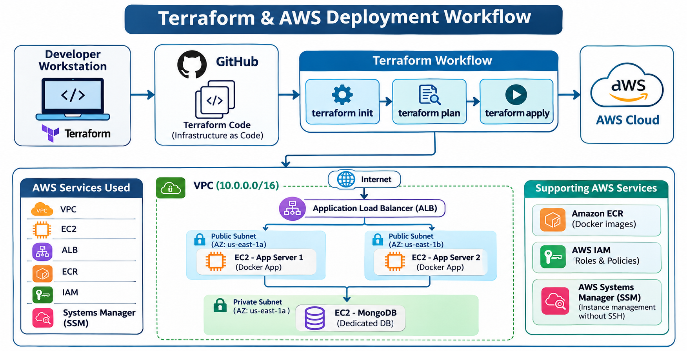

# AWS Automation Terraform DevOps Project

## Project Overview

This project demonstrates the automated provisioning of AWS infrastructure using Terraform (Infrastructure as Code).

The objective is to provision an application environment with two application EC2 instances distributed across different Availability Zones, an Application Load Balancer, and a dedicated MongoDB EC2 instance hosted in a private subnet.

The infrastructure demonstrates AWS networking, compute, security, storage, container registry integration, and infrastructure automation.

## Architecture

The infrastructure is designed with the following components:

- One custom VPC with CIDR `10.0.0.0/16`
- Two public subnets across different Availability Zones
- One private subnet for MongoDB
- Internet Gateway for public subnet connectivity
- NAT Gateway for private subnet outbound connectivity
- Two application EC2 instances
- One dedicated MongoDB EC2 instance
- Application Load Balancer
- Target groups and health checks
- Amazon ECR repository for Docker images
- IAM role and instance profile
- AWS Systems Manager for SSH-less instance management
- Encrypted EBS storage for MongoDB data

### AWS Infrastructure Architecture



### Terraform Deployment Workflow



## AWS Services Used

| AWS Service               | Purpose                                  |
| ------------------------- | ---------------------------------------- |
| Amazon VPC                | Isolated network environment             |
| Amazon EC2                | Application and MongoDB servers          |
| Application Load Balancer | Distributes application traffic          |
| Amazon ECR                | Stores Docker images                     |
| Amazon EBS                | Persistent MongoDB data storage          |
| AWS IAM                   | Roles and permissions                    |
| AWS Systems Manager       | Secure instance management               |
| Internet Gateway          | Internet connectivity for public subnets |
| NAT Gateway               | Outbound connectivity for private subnet |
| Security Groups           | Network traffic control                  |

## Infrastructure as Code

Terraform is used to define and provision the AWS infrastructure.

The configuration is organized into separate Terraform files for networking, security, compute, storage, IAM, ECR, and load balancing.

The project uses:

- Terraform configuration files (`.tf`)
- Input variables
- Terraform outputs
- AWS provider configuration
- Terraform dependency management through `.terraform.lock.hcl`

## Application Architecture

Two application instances are intended to run in separate Availability Zones.

The Application Load Balancer distributes incoming HTTP traffic to the configured application target group or groups and performs health checks.

The application instances communicate with the MongoDB server through its private IP address over TCP port `27017`.

MongoDB is hosted in a private subnet and is not directly accessible from the public internet.

## Security

The infrastructure incorporates the following security configurations:

- Security groups restrict application traffic.
- MongoDB accepts connections only from the application security group.
- EC2 instances use IAM instance profiles.
- AWS Systems Manager is used for instance management instead of SSH.
- MongoDB is hosted in a private subnet.
- EBS volumes are encrypted.
- The MongoDB data volume is separate from the EC2 root volume.

## Container Registry

Amazon Elastic Container Registry (ECR) is used to store the Docker application image.

The application image is built locally and pushed to the ECR repository. The application EC2 instances are intended to pull and run the image from ECR.

## Deployment Workflow

The planned infrastructure and application deployment workflow is:

1. Configure Terraform and AWS provider settings.
2. Initialize Terraform using `terraform init`.
3. Validate the Terraform configuration.
4. Review the proposed infrastructure changes using `terraform plan`.
5. Provision the AWS networking and infrastructure resources after reviewing and approving the plan.
6. Create the ECR repository through Terraform.
7. Authenticate Docker with Amazon ECR.
8. Build and push the Docker application image to ECR.
9. Configure application instances to pull and run the image.
10. Verify MongoDB connectivity.
11. Validate ALB target health and application availability.

## Terraform Commands

Initialize the Terraform working directory:

```bash
terraform init
```

Format Terraform configuration files:

```bash
terraform fmt
```

Validate the Terraform configuration:

```bash
terraform validate
```

Review the infrastructure execution plan:

```bash
terraform plan
```

Apply infrastructure changes only after reviewing and approving the plan:

```bash
terraform apply
```

## Future CI/CD Integration

GitHub Actions is planned for future CI/CD integration.

The intended automation includes:

- Terraform formatting and validation.
- Terraform plan execution.
- Controlled infrastructure deployment.
- Docker image build and push to Amazon ECR.
- Application deployment through AWS Systems Manager.
- AWS authentication through GitHub Actions OIDC instead of long-lived AWS access keys.

## Project Repository Structure

```text
aws-automation-terraform-devops-project/
│
├── images/
│   ├── aws-infrastructure.png
│   └── terraform-workflow.png
│
├── README.md
├── .gitignore
├── .terraform.lock.hcl
│
├── versions.tf
├── provider.tf
├── variables.tf
├── terraform.tfvars.example
├── outputs.tf
│
├── vpc.tf
├── subnets.tf
├── private-subnets.tf
├── internet-gateway.tf
├── route-tables.tf
├── private-route-tables.tf
│
├── security-groups.tf
├── security-group-rules.tf
├── mongodb-security-group.tf
│
├── iam.tf
├── ecr.tf
├── ec2.tf
├── mongodb-ec2.tf
├── mongodb-storage.tf
│
├── nat-gateway.tf
├── alb.tf
├── target-group.tf
├── listeners.tf
│
├── user-data.sh
└── mongodb-user-data.sh
```

_Note: The repository structure should reflect the actual filenames present in the project. Remove or rename entries in this example if your local filenames differ._

## Learning Outcomes

This project provides practical experience with:

- Infrastructure as Code using Terraform.
- AWS VPC and subnet design.
- Public and private networking.
- Internet Gateway and NAT Gateway configuration.
- Security group configuration.
- IAM roles and instance profiles.
- EC2 provisioning across Availability Zones.
- EBS storage attachment and mounting.
- ECR container image management.
- Application Load Balancer configuration.
- AWS Systems Manager.
- Terraform variables and outputs.
- Terraform initialization, formatting, validation, and planning.

## Project Status

This is a hands-on learning project.

Infrastructure configuration and planning are being developed before deployment. Deployment, application connectivity, health checks, and end-to-end testing will be documented after they have been completed and verified.

## Important Notes

- This project is intended for learning and demonstration purposes.
- AWS resources may incur charges when provisioned.
- Review AWS pricing before deploying the infrastructure.
- NAT Gateway, Application Load Balancer, EC2, and EBS resources can incur ongoing charges.
- Clean up temporary resources after testing while preserving any data or backups that need to be retained.
- Never commit personal Terraform variable files, AWS credentials, Terraform state files, or other sensitive information to GitHub.
